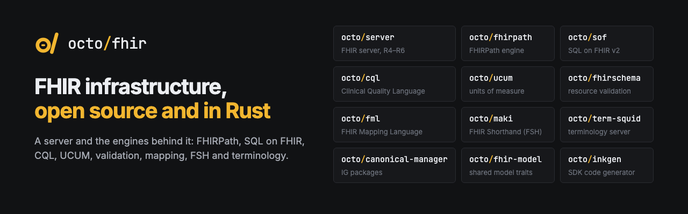

  

**OctoFHIR builds open-source FHIR infrastructure in Rust.** Our FHIR server on PostgreSQL has a
keyboard-first web console for REST, SQL, GraphQL, FHIRPath and CQL. The server is built on our own
engines for FHIRPath, SQL on FHIR, CQL, UCUM and FHIRSchema validation. Next to them we build tools
for the FHIR Mapping Language, FHIR Shorthand, terminology and SDK generation. Each engine is a
standalone crate you can embed in your own application, and most of them also ship a command-line
tool.

## Projects

### Server

| Project | What it does | Crate |
|---|---|---|
| [server-rs](https://github.com/octofhir/server-rs) | Fast FHIR server in Rust (R4–R6) on PostgreSQL, with a keyboard-first web console for REST, SQL, GraphQL, FHIRPath and CQL. | — |

### Languages & engines

| Project | What it does | Crate |
|---|---|---|
| [fhirpath-rs](https://github.com/octofhir/fhirpath-rs) | FHIRPath engine that follows the spec text, with a static analyzer, terminology support and a CLI with a REPL. |  |
| [sof](https://github.com/octofhir/sof) | SQL on FHIR v2: runs ViewDefinitions in memory or compiles them to PostgreSQL and DuckDB SQL. Passes the official content tests (144/144). |  |
| [cql-rs](https://github.com/octofhir/cql-rs) | Clinical Quality Language in Rust: parser, ELM translator, evaluator and the `cql` CLI (prebuilt binaries). Passes the official cql-tests (1693/1693). |  |
| [fml-rs](https://github.com/octofhir/fml-rs) | FHIR Mapping Language: parser, formatter, type checker and StructureMap engine behind one `fml` command. | — |
| [ucum-rs](https://github.com/octofhir/ucum-rs) | UCUM units of measure: validation, comparison and conversion with exact decimal factors. Also works in `no_std` and WebAssembly. |  |

### Data & terminology

| Project | What it does | Crate |
|---|---|---|
| [fhirschema-rs](https://github.com/octofhir/fhirschema-rs) | FHIRSchema for Rust: compiles StructureDefinitions and validates FHIR R4–R6 resources. |  |
| [canonical-manager-rs](https://github.com/octofhir/canonical-manager-rs) | FHIR package manager: installs IG packages, then resolves and searches canonical resources. Library and CLI. |  |
| [fhir-model-rs](https://github.com/octofhir/fhir-model-rs) | Shared FHIR model, terminology and server traits (`ModelProvider`) used across the OctoFHIR crates. |  |
| [term-squid](https://github.com/octofhir/term-squid) | FHIR terminology server on Rust and PostgreSQL: `$lookup`, `$expand`, `$validate-code` and `$translate` for R4, R5 and R6. | — |

### Tooling

| Project | What it does | Crate |
|---|---|---|
| [maki](https://github.com/octofhir/maki) | FHIR Shorthand toolchain: SUSHI-compatible build, GoFSH, linter and formatter. | — |
| [inkgen](https://github.com/octofhir/inkgen) | Generates TypeScript (with Zod schemas and profile classes) or Rust code from FHIR packages. | — |
| [vscode-extension](https://github.com/octofhir/vscode-extension) | FHIRPath in VS Code: highlighting, live validation, completion and a playground, running fhirpath-rs as WebAssembly. | — |
| [banshee](https://github.com/octofhir/banshee) | PostgreSQL parser, formatter, linter and language server. It powers the server's SQL console. |  |
| [otter](https://github.com/octofhir/otter) | Embeddable TypeScript/JavaScript runtime on its own bytecode VM. |  |

## Why OctoFHIR

- **Rust at the core.** The engines are fast and memory-safe. Our CLIs and the server ship as single
  binaries, so there is no JVM or other runtime to install.
- **Spec first.** We implement against the specification text and check ourselves with the
  official suites: FHIR262 for the server, the fhir-test-cases FHIRPath tests, the SQL on FHIR
  content tests, the UCUM functional tests and cql-tests. When the tests and the spec disagree, we
  follow the spec.
- **Embeddable.** Each engine is a standalone crate behind small traits, so you can use one piece
  without adopting the whole stack.
- **JSON only.** The server and the engines work on FHIR JSON. There is no XML to configure, convert
  or maintain.

## Links

- [Server documentation](https://octofhir.github.io/server-rs/) ·
  [Getting started](https://octofhir.github.io/server-rs/getting-started/)
- [SQL on FHIR docs](https://octofhir.github.io/sof) · [banshee docs](https://octofhir.github.io/banshee/)
- [FHIRPath benchmarks](https://github.com/octofhir/fhirpath-benchmarks)
- [HL7 FHIR](https://hl7.org/fhir/)
- [Support our work](https://boosty.to/octoshikari)

Issues and pull requests are welcome in any of the repositories above.
